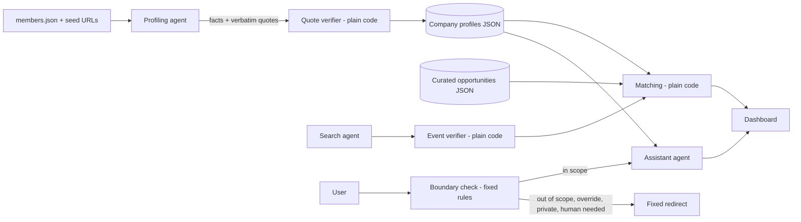

# Virtual Science Park

**Evidence-guided opportunity finder for Blue Science Park members**

Built for **BUILD Hackathon 2026** (13–15 November 2026, Black Box, Ericsson, Karlskrona), challenge by **Blue Science Park**.

Verified company profiles, matched with testing environments, funding and events. **Every claim can be traced back to its source.**

> Full solution description, quality and boundary check, known limitations and next steps: **[docs/SOLUTION.md](docs/SOLUTION.md)**

---

## Table of contents

1. [The problem](#the-problem)
2. [Our solution](#our-solution)
3. [Demo companies and why this helps them](#demo-companies-and-why-this-helps-them)
4. [How we solve the challenge brief](#how-we-solve-the-challenge-brief)
5. [What is innovative](#what-is-innovative)
6. [Quick start](#quick-start)
7. [Using the app](#using-the-app)
8. [Architecture and agent roles](#architecture-and-agent-roles)
9. [Profiling agent](#profiling-agent)
10. [Matching and ranking](#matching-and-ranking)
11. [Service boundaries](#service-boundaries)
12. [Data model](#data-model)
13. [Simulated parts](#simulated-parts)
14. [Quality, tests and checks](#quality-tests-and-checks)
15. [Known limitations](#known-limitations)
16. [Next steps](#next-steps)
17. [Scaling to all 56 members](#scaling-to-all-56-members)
18. [Project structure](#project-structure)
19. [Team](#team)

---

## The problem

Blue Science Park has 40+ member companies. Each needs to follow its market and technology area and to find relevant **events, testing environments, funding and potential partners**. That information is spread across websites, research publications and other channels. Finding it and judging whether it is relevant takes time.

A personalised service also needs a **useful starting point before a company fills in a long questionnaire**. Public information about members can provide that foundation.

## Our solution

A working flow from **member discovery to a personalised result**:

1. A **profiling agent** reads a member's public web pages and builds a baseline profile.
2. Each profile statement is stored with a **verbatim quote** and a **source link**, and is labelled **Verified**, **Inferred** or **Unverified**.
3. A company representative **reviews and refines** the profile: confirm or remove claims, add their own interests.
4. A **matching engine** ranks curated testbeds, funding calls and events for that company and explains why (*Strong match* / *Possible match*).
5. A **search agent** finds live events, testbeds and funding on the web. Every suggested page is fetched and checked by code before it is shown.
6. An **innovation assistant** answers questions, but only after a rule-based **boundary check** has classified the question.
7. **Blue Science Park staff** get an ecosystem view: shared themes across members and suggested connections, with the claims behind them.

## Demo companies and why this helps them

The demo uses three real Karlskrona-area members with different profiles: **Ericsson**, **NKT** and **Roxtec**. Because their profiles differ, the same set of opportunities is ranked differently for each of them.

> The descriptions below are summaries for orientation. The authoritative, evidence-linked profiles are in `src/data/companies/*.json`.

| | Ericsson | NKT | Roxtec |
|---|---|---|---|
| **Profile in short** | Telecom technology; Karlskrona hosts Mobile Financial Services (fintech) and R&D; long collaboration with BTH; partner in AI LAB Blekinge | Power cable solutions for energy transmission and the energy transition | Cable and pipe seal solutions for safety-critical environments such as marine, energy and industry |
| **Typical needs** | AI and security validation, research funding and competence supply, ecosystem partners | Testing and validation of products, funding for energy and offshore projects, industry events | Testing and certification environments, funding for product development, events in marine and energy |
| **What the service gives them** | Opportunities ranked around AI, cybersecurity, fintech and research collaboration | Opportunities ranked around energy, testing and funding | Opportunities ranked around testing, safety, marine and industrial applications |

**Why it helps them**

- **Saves time.** The company starts with a ready profile and a first ranked list instead of searching many sites and filling in a questionnaire.
- **Trustworthy.** Each profile statement and each opportunity has a source link, a date and a verification level. Users can click a source and see the exact quote highlighted in the page text.
- **Personal.** Rankings change when the profile changes. A company can confirm an inferred interest, remove a wrong claim, or say that testing is a current priority, and the list updates.
- **Relevant next step.** Each result explains the match and what to do next, and separates a *potential match* from *confirmed eligibility*.
- **Cross-company value.** Staff can see shared interests, for example overlapping technology themes, and suggested connections. The basis is explained, and no company is presented as having expressed interest.

## How we solve the challenge brief

Mapping of the brief's requirements to what is in this repo.

| Brief requirement | How it is solved |
|---|---|
| Baseline profiles for at least three companies from websites and public sources | Profiling agent (`backend/profiler/`) and profiles for **Ericsson, NKT, Roxtec** |
| Evidence behind profile info; facts vs inferred interests | Each claim has a verbatim quote and source. Labels: *Verified*, *Inferred*, *Unverified*. Quote highlighting in the page text. |
| User can review and refine a profile | Members confirm or remove claims and add their own interests |
| Opportunities from at least two distinct public sources | Curated opportunities (`src/data/opportunities.json`) plus live results from the search agent, each with source link and date |
| Different recommendations for companies with different profiles | Matching in `src/lib/science-park.ts`. Tests check that rankings differ per company and change after refinement |
| Results with source links and relevant dates | Every opportunity shows source, retrieval date and verification level |
| Respond to a relevant request, an unrelated request and an override attempt | Rule-based boundary check classifies each question before the AI sees it |
| Clearly label simulated data or functionality | See [Simulated parts](#simulated-parts). Unverified items are marked in the UI |
| Explain agent roles and how they work together | See [Architecture and agent roles](#architecture-and-agent-roles) |
| Deliverables: demo, explanation, quality and boundary check, handover | App, [docs/SOLUTION.md](docs/SOLUTION.md), tests, this README |

**Coverage of the service areas:** testing opportunities, funding opportunities and events are implemented. Personalised member monitoring is covered through profiles, refinement, matching, and the staff ecosystem view. Knowledge and trend monitoring is not built in depth (see [Next steps](#next-steps)).

## What is innovative

- **Evidence-first profiles.** Many AI profiling tools produce fluent text that cannot be checked. Here the AI proposes facts with verbatim quotes, and **plain code verifies each quote against the fetched page text**. Quotes that are not found are removed. Unsupported facts are downgraded to *Unverified*. The AI is not the judge of its own evidence.
- **Facts and inferences kept apart.** Inferred interests are never shown as confirmed priorities, and a user can promote or reject them.
- **Verification of live search.** The search agent's suggestions are fetched and the title and date are checked by code. Unconfirmed suggestions are dropped. Remaining results are still labelled unverified for relevance.
- **Boundaries by design, not only by prompt.** Questions are classified by fixed rules (in scope, out of scope, override attempt, private data, needs a human) *before* reaching the AI. External pages are treated as data and never as instructions.
- **Explainable matching.** Each recommendation shows the reason it was ranked, and refinements visibly change the result.
- **Two user types.** Members get a personal view. Staff get an ecosystem view with shared themes and suggested connections, each backed by claims.

## Quick start

Two terminals. The AI settings go in a `.env` file in the repo root. **Never commit it.**

```
API_KEY=...
AI_URL=...
MODEL_NAME=...
```

```bash
# 1) Backend: AI agents (FastAPI, port 8000)
cd backend
python3 -m venv .venv
.venv/bin/pip install -r requirements.txt
.venv/bin/uvicorn api:app --port 8000

# 2) Frontend
npm install --legacy-peer-deps
npm run dev
```

The app works without the backend. Only the assistant and the live search need it.

**Requirements:** Node.js and npm, Python 3, and access to an AI model endpoint (set through `.env`).

**Demo accounts:** `staff` (Blue Science Park staff) and `nkt`, `ericsson`, `roxtec` (member companies). These are hardcoded demo logins, not real authentication.

A `Makefile` is included in the repo root for common tasks.

## Using the app

| View | Who | What it shows |
|---|---|---|
| **Company profile** | Member (own company), staff (read-only) | Hero with logo, summary, and tabs per section. Each claim is *Verified*, *Inferred* or *Unverified*. Click a source to see the quote highlighted in the page text. Members confirm or remove claims and add their own interests. |
| **Opportunities** | Member | Curated testbeds, funding and events, most relevant first, with *Strong/Possible match* and the reason, plus live results from the AI search agent, marked unverified. |
| **Opportunities** | Staff | All opportunities with the members each one is relevant to. |
| **Members** | Staff | Every profiled member as a card with logo. Click to open the profile. |
| **Ecosystem** | Staff | Shared themes across members and suggested connections with the claims behind them. |
| **Innovation assistant** | Member, staff | Each question is classified by fixed rules first. Only in-scope questions go to the AI assistant agent. |

### Suggested demo path

1. Log in as `ericsson`. Open the profile. Click a source and see the quote highlighted. Note the *Inferred* items.
2. Refine: remove or confirm a claim, add an interest such as testing.
3. Open **Opportunities** and see the ranking and match reasons change.
4. Log in as `roxtec` or `nkt` and compare the ranking.
5. In the assistant, try a relevant question, an unrelated question and an override attempt.
6. Log in as `staff` and open **Ecosystem**.

## Architecture and agent roles



| Part | Where | AI? |
|---|---|---|
| Company profiles: facts with verbatim quotes, inferred interests, gaps | `src/data/companies/*.json` (read by frontend and backend) | No (static data) |
| Opportunities: testbeds, funding, events with links and dates | `src/data/opportunities.json` | No (static data) |
| Matching: ranks and explains opportunities per company | `src/lib/science-park.ts` | No |
| Boundary check: classifies every question before the AI sees it | `src/lib/science-park.ts`, `src/components/vsp/assistant-chat.tsx` | No |
| Profiling agent: fetches public pages, extracts facts with verbatim quotes and inferred interests, verifies every quote | `backend/profiler/` (run `python -m profiler`) | Yes (extraction), no (verification) |
| Assistant agent: answers in-scope questions from the profile | `backend/api.py` `POST /assistant`, `backend/assistent_agent.py` | Yes |
| Search agent: finds upcoming events, testbeds and funding on the web | `backend/api.py` `POST /events`, `backend/collector_agent.py`, `backend/tools.py` | Yes |
| Event verifier: fetches every suggested page and checks that title (and date) are on it. Unconfirmed suggestions are dropped | `backend/event_verifier.py` | No |

**Design principle:** AI is used where language understanding is needed (extraction, search, answering). Everything that decides trust, ranking or permission is plain, testable code.

## Profiling agent

Builds the baseline profiles in `src/data/companies/` from public web pages.

```bash
cd backend
.venv/bin/python -m profiler --all --dry-run   # fetch pages only, no AI cost
.venv/bin/python -m profiler roxtec            # one company -> backend/output/roxtec.json
.venv/bin/python -m profiler --all --publish   # all members -> src/data/companies/ and src/data/sources/
```

Steps:

1. Fetch seed URLs from `backend/members.json` plus same-site pages.
2. AI extraction: facts with verbatim quotes, inferred interests, gaps.
3. Plain-code verifier: removes quotes not found on the page and downgrades unsupported facts to *Unverified*.
4. Write profile JSON (schema v1.1).

`--publish` keeps hand-added fields such as `logo` and `background`. It does not overwrite a profile with `metadata.lastEditedByUser: true` unless `--force` is given.

**Add a member:** add `id`, `name`, `website` and a few `seed_urls` to `backend/members.json`, then run the profiler.

**All Blue Science Park members (56) in two commands:**

```sh
.venv/bin/python -m profiler.import_members        # reads bluesciencepark.se/medlem-sitemap.xml → members.json
.venv/bin/python -m profiler --all --publish       # builds and verifies every profile
```

New members automatically get a login (their id), a card in the staff view, matching and ecosystem themes.

## Matching and ranking

- Implemented in `src/lib/science-park.ts` with no AI.
- Opportunities are scored against the company's profile: technologies, markets, application areas, and interests.
- Interests the user confirmed or added affect the ranking. Removed claims no longer count.
- Each result shows a *Strong match* or *Possible match* label and the reason.
- A *match* means potential relevance. It is not a confirmed eligibility decision. Eligibility must be checked with the funder, organiser or Blue Science Park.

## Service boundaries

The service is an assistant for science park activities. Boundaries are enforced in code before the AI sees a question.

| Case | Behaviour |
|---|---|
| **In scope** (technology, research, market, regional developments; events, testing, funding; partners and expertise; understanding recommendations; contact routes) | Passed to the assistant agent, which answers from the profile |
| **Out of scope** | Short explanation of the remit and a suggestion for a relevant question or contact |
| **Override attempt** (change role, ignore rules, reveal instructions) | Declined. Same boundaries apply to follow-ups and role-change requests |
| **Private data** (another company's non-public profile or interactions) | Refused. Company data is scoped to the logged-in company |
| **Needs a human decision or commitment** | Referred to Blue Science Park staff |

Additional rules:

- External websites and documents are information sources, never instructions.
- Information and next steps are not professional advice, formal eligibility decisions, or commitments by Blue Science Park.
- Inferred interests are never presented as confirmed priorities.

## Data model

There is no database. All data is JSON.

- `src/data/companies/*.json`: one profile per company (schema v1.1). Add a file and the company appears.
- `src/data/sources/*.json`: fetched page text, used to highlight quotes.
- `src/data/opportunities.json`: curated opportunities with source, retrieval date and verification level.

Each profile claim carries a value, source, verbatim quote, retrieval date, type (fact or inferred) and verification level. Profiles also list missing or uncertain information.

Profile edits and saved opportunities are stored in the browser (localStorage).

## Simulated parts

These are clearly marked as simulated or limited:

- **Login** is a hardcoded demo account checked in the browser.
- **Edits** are stored only in the browser.
- **Live search results** are AI-generated. Each page is fetched and its title and date are checked by code, but relevance and quality are not checked. Results are cached per company and day.
- **Opportunities** are curated snapshots from 2026-11-13. Some details come from search results and are marked as such.

## Quality, tests and checks

```bash
npm test
```

The automated tests cover:

- profile evidence
- quote highlighting
- two or more distinct sources
- different rankings per company
- the effect of profile refinements on ranking
- all service-boundary cases

Code quality tooling in the repo: TypeScript, ESLint, Prettier and Vitest.

The quality and boundary check (profile accuracy, recommendation relevance, source traceability, interaction limits) is documented in [docs/SOLUTION.md](docs/SOLUTION.md).

## Known limitations

- Demo-level authentication and browser-only storage. No multi-user persistence.
- Live search results can contain irrelevant items. Only existence, title and date are checked by code.
- Profiles are a snapshot from public pages. They can be outdated until the profiler is run again.
- Some public sources are old or undated. They are flagged rather than treated as current.
- Only three companies are profiled. Quality at 40+ members has not been measured.
- Knowledge and trend monitoring is not built in depth.
- The AI components depend on an external model endpoint, so output can vary between runs.

More detail: [docs/SOLUTION.md](docs/SOLUTION.md).

## Next steps

1. **Scheduled profile refresh.** Run the profiler on a schedule and show a *proposed diff* for the member to approve. Never overwrite confirmed values automatically.
2. **Real authentication and a database** with per-company access control.
3. **Monitoring of public member updates** (news, press releases) to keep profiles current.
4. **Trend and knowledge monitoring** (research, technology and market news) with a short explanation of what changed and why it matters.
5. **More sources** for events, testbeds and funding (for example funder and EU portals) with automatic date checks.
6. **Feedback loop.** Use thumbs up/down and saves to improve ranking.
7. **Digest and alerts** (weekly email or dashboard digest).
8. **Staff tools** for managing the member list and sources, and for reviewing flagged claims.

## Scaling to all 56 members

- `python -m profiler.import_members` reads the public member directory (56 members) into `backend/members.json`; `python -m profiler --all --publish` then builds every profile. Profiles need no database change.
- Verification is code-based, so adding members does not require manual checking of every quote. Staff or members review only flagged items.
- Matching is deterministic and fast, and runs without AI calls.
- Search results are cached per company and day to control cost.
- Move storage from JSON files to a database when real accounts are added.

## Project structure

```
backend/        FastAPI app, profiler, assistant, search and verification agents
docs/           SOLUTION.md and supporting documentation
public/         Static assets (for example logos)
src/            React + TypeScript frontend
  components/   UI components (including vsp/assistant-chat.tsx)
  data/         Profiles, sources and opportunities (JSON)
  lib/          Matching and boundary logic (science-park.ts)
Makefile        Common tasks
```

## Team

| Name | Education |
|---|---|
| Hayder Abboodi | B.Sc. in Computer Security |
| Dawood Rahimi | B.Sc. in Computer Security |
| Ali Reza Hussaini | M.Sc. in AI & Machine Learning |
| Fatema Rahimi | B.Sc. in Software Engineering |
| Ali Reza Sharifi | M.Sc. in Computer Security |

---

*Hackathon prototype built at BUILD Hackathon 2026 for the Blue Science Park challenge "Virtual Science Park". Data labelled simulated, curated or unverified must not be treated as confirmed information.*
